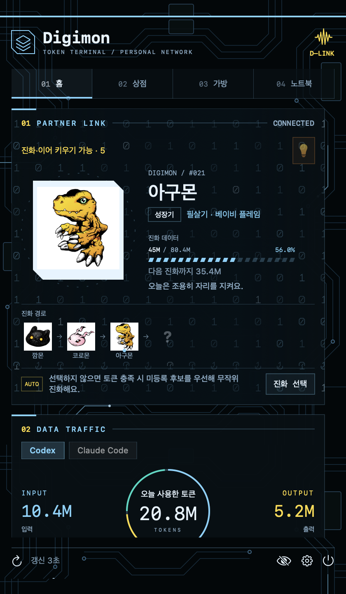
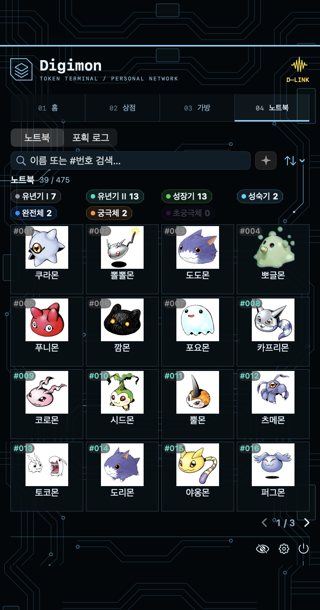
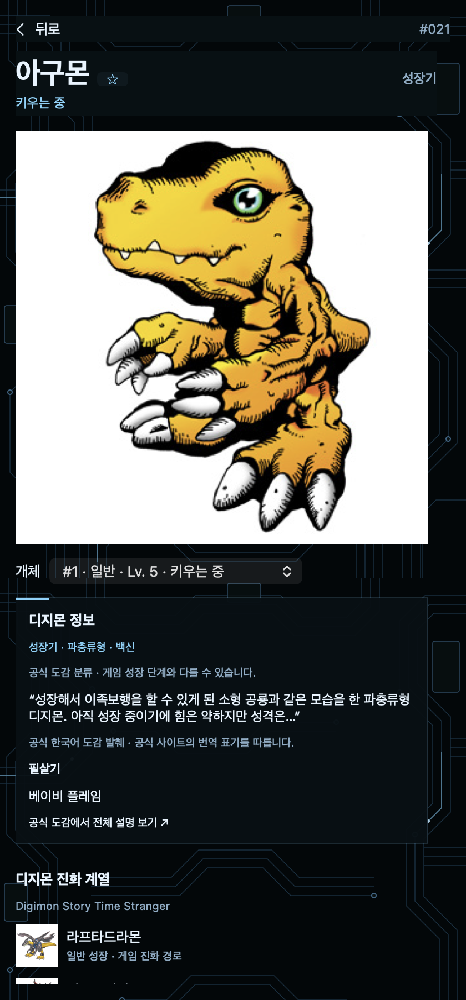
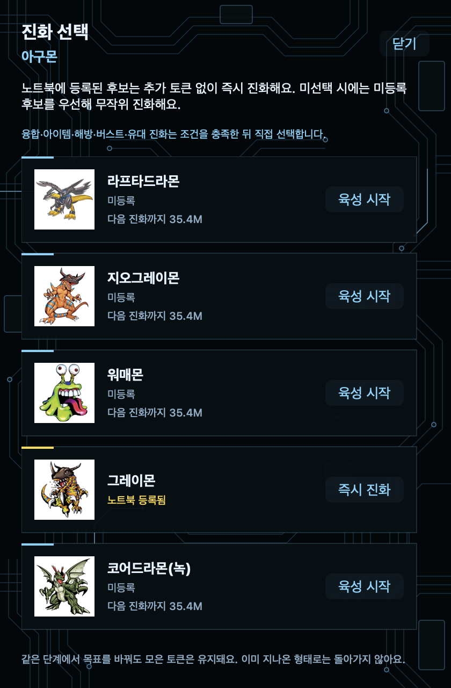
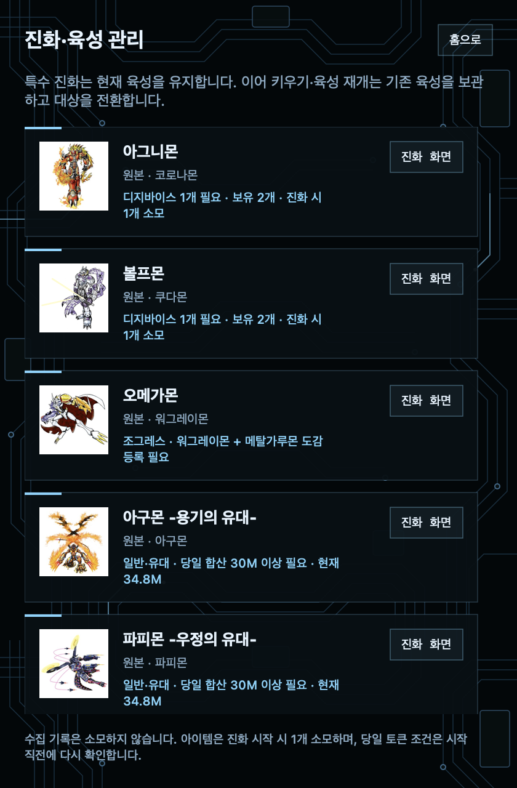
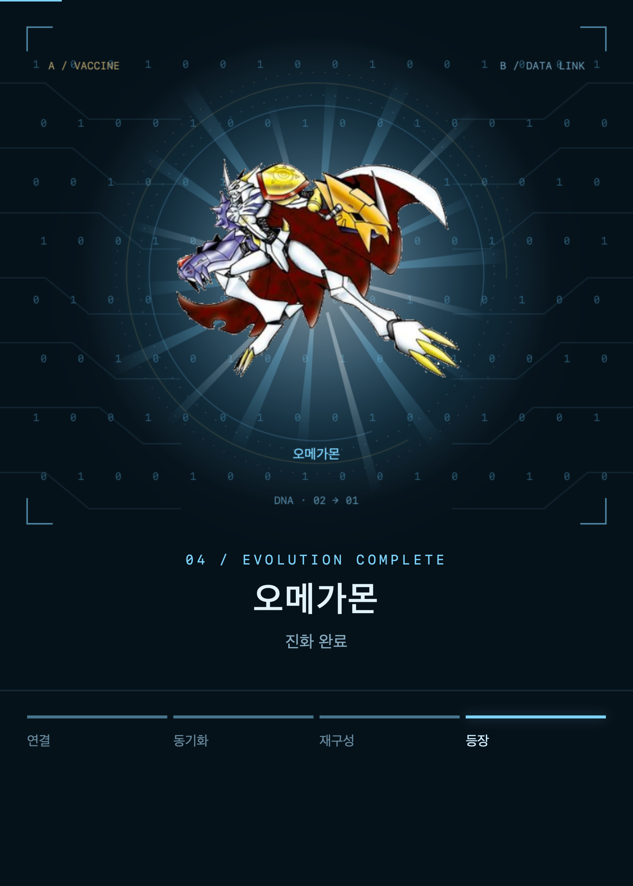
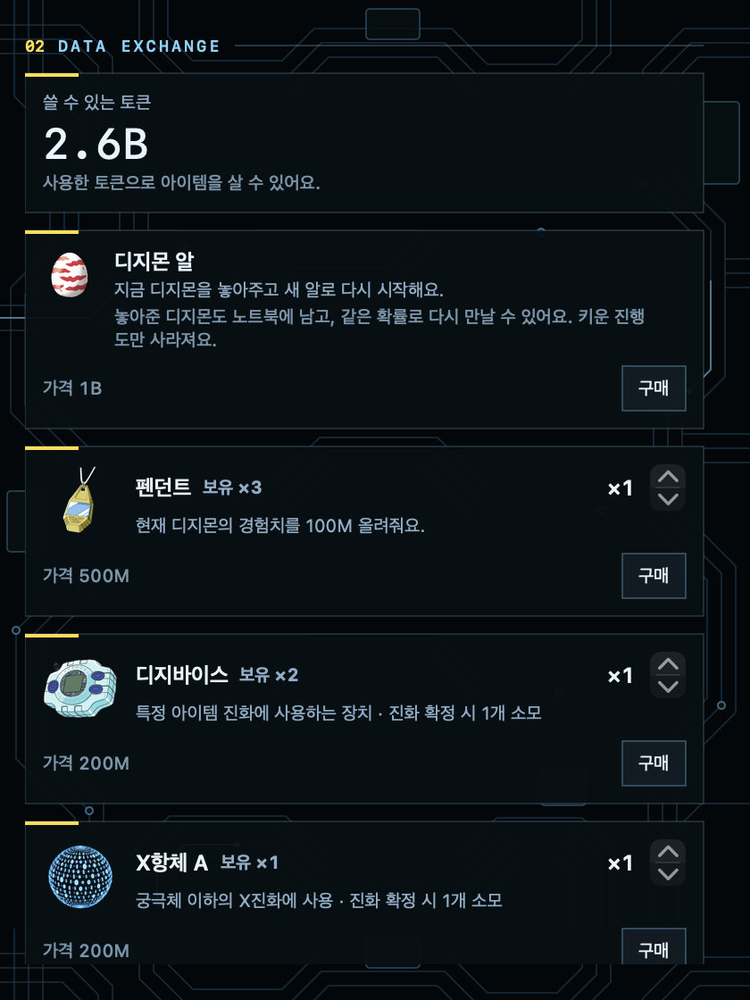
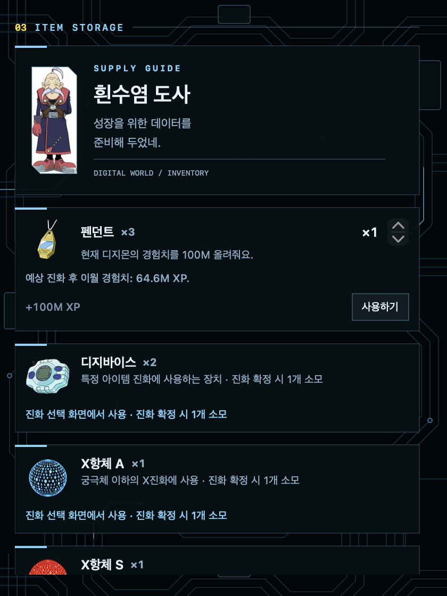

<div align="center">


# DigiTokenBar

**AI 코딩에 사용한 토큰으로, macOS 메뉴바에서 디지몬을 키우세요.**

[English](README.md) · **한국어** · [日本語](README.ja.md)
</div>

[chattymin/PokeTokenBar](https://github.com/chattymin/PokeTokenBar)를 기반으로 만든
비공식·비상업 목적의 디지몬 팬 프로젝트입니다. Claude Code·Codex 등 지원 도구의
로컬 사용 기록을 읽어 부화·분기 진화·융합·노트북 수집으로 연결합니다.

> **소스 코드는 MIT입니다. 디지몬 이미지·문구·상표·데이터의 권리는 별도입니다.**
> 외부 이미지는 앱에 포함하지 않고 실행 시 내려받아 사용자 Mac에 캐시합니다.
> 도감 데이터·프로필 발췌는 포함됩니다. 출처 표시는 이용 허가가 아니며,
> 공개 바이너리 배포의 권리 확인은 완료되지 않았습니다.
> [프로젝트 고지](NOTICE.md) · [자산별 출처·권리 상태](THIRD_PARTY_NOTICES.md) · [검증 보고서](docs/reference/distribution-validation.md)

## 화면으로 보는 주요 기능

아래 이미지는 실제 제품 화면 코드를 한국어·가상 샘플 데이터로 렌더링한 화면입니다. 개인 사용 기록이나 새로 그린 시안이 아닙니다. 디지몬·아이템 이미지의 권리는 각 소유자에게 있으며 [출처와 권리 안내](THIRD_PARTY_NOTICES.md)를 참고하세요.

<table>
<tr>
<td width="45%" align="center"></td>
<td width="55%"><h3>코딩한 만큼 자라는 파트너</h3><p>오늘 사용한 토큰과 디지몬 성장 상태를 함께 확인합니다. Codex·Claude Code를 전환하고, 성장 게이지를 확인하며, 특수 진화가 준비되면 주황색 전구로 후보를 엽니다.</p></td>
</tr>
<tr>
<td width="45%" align="center"></td>
<td width="55%"><h3>475종을 모으는 노트북</h3><p>모은 디지몬 수를 확인하고 성장 단계별로 분류합니다. 이름·타임 스트레인저 번호 검색과 페이지 이동으로 수집한 디지몬을 찾아보세요.</p></td>
</tr>
<tr>
<td width="45%" align="center"></td>
<td width="55%"><h3>디지몬을 자세히 알아보기</h3><p>큰 이미지와 성장 단계, 공식 프로필 발췌, 필살기, 다음 진화 경로를 확인합니다. 출처 링크에서는 공식 도감의 전체 설명을 볼 수 있습니다.</p></td>
</tr>
<tr>
<td width="45%" align="center"></td>
<td width="55%"><h3>다음 진화의 갈림길 선택</h3><p>노트북에 등록된 일반 후보는 즉시 진화하고, 미등록 후보는 성장 게이지를 채웁니다. 선택하지 않으면 미수집 일반 후보를 우선해 자동으로 진화합니다.</p></td>
</tr>
<tr>
<td width="45%" align="center"></td>
<td width="55%"><h3>진화 조건을 한눈에 확인</h3><p>전구 알림에서 가능한 진화·육성 후보를 확인합니다. 필요한 재료 디지몬, 아이템, 당일 토큰 조건을 후보별로 표시합니다. 융합 재료는 노트북 수집 기록을 사용하며 수집한 디지몬을 없애지 않습니다.</p></td>
</tr>
<tr>
<td width="45%" align="center"></td>
<td width="55%"><h3>데이터가 모여 완성되는 융합</h3><p>워그레이몬과 메탈가루몬이 오메가몬으로 융합합니다. 데이터 결합, 그림자, 0·1 띠와 등장 후 유지되는 빛으로 연출합니다. 아이템·특수 일반 진화는 그림자 단계부터 시작합니다.</p></td>
</tr>
<tr>
<td width="45%" align="center"></td>
<td width="55%"><h3>토큰으로 사고, 가방에서 사용</h3><p>가상 토큰으로 알·펜던트·디지바이스·X항체·전용 캡슐을 구매합니다. 가방에서 수량을 확인하고 펜던트를 사용하며, 진화 아이템은 진화 확정 시 소모합니다. 실제 결제는 없습니다.</p></td>
</tr>
</table>

## 주요 기능

- **475종 노트북:** 타임 스트레인저 번호·성장 단계·한글/영문 검색·수집 카운터·공식 프로필 발췌·필살기.
- **일반 진화:** 직접 선택하거나, 게이지를 채우면 미수집 일반 후보를 우선해 무작위 진화.
- **특수 진화:** 수집한 재료를 사용하는 융합, 전용 캡슐·디지바이스·X항체, 당일 토큰 조건.
- **진화 알림:** 주황·노랑 전구에서 준비된 결과를 목록으로 확인하고 연출 후 노트북에 등록.
- **이어 키우기:** 특수 진화 결과에 미수집 일반 후속 루트가 있으면 기존 개체를 보관하고 육성.
- **상점·가방:** 알·펜던트·디지바이스·X항체 A/S·전용 캡슐. 실제 결제 없는 가상 토큰 재화입니다.
- **사용량 대시보드:** 오늘 사용량·입출력/캐시 구성·비용·기존 공급자별 한도 기능.
- **검은색·하늘색 테마:** 회로·0/1 데이터 배경과 디지바이스 팬 아이콘.

## 육성 규칙

1. 7종의 유년기 시작 개체 중 하나가 부화합니다. 미수집 유년기를 확정 우선하는 방식은 아닙니다.
2. 일반 육성의 등록된 직접 후보는 즉시 진화할 수 있고, 미등록 후보는 필요한 게이지를 채웁니다.
3. 일반 진화가 더 없는 최종 형태도 게이지 100%를 채워야 육성이 완료됩니다.
4. 보관 개체가 있으면 그 개체로 자동 복귀하며, 없으면 새 알을 받습니다.
5. 새 `이어 키우기`는 알 상태에서 시작할 수 없습니다. 현재 1개 + 보관 1개만 가능합니다.
6. 보관 개체의 경험치는 오르지 않습니다. 교환할 때 형태·선택·게이지·프로필을 유지합니다.
7. 이어 키우기에서는 수집 완료 분기를 숨기고, 미수집 후속 형태로 연결되는 등록 형태는 무료 경유합니다.
8. 융합은 육성과 별개로 노트북에 등록합니다. 재료 디지몬을 없애지 않고 현재/보관 개체를 교체하지 않습니다.
9. 진화 아이템은 확정 시 1개 소모합니다. 당일 조건은 실제 토큰 합산이며 펜던트 경험치나 난이도 배율을 적용하지 않습니다.

진화 관계는 수집한 게임 데이터와 앱에서 정한 명시적 규칙의 조합입니다.
전체 작품의 공식 설정을 완전히 검증한 데이터베이스는 아닙니다.
일러스트는 정적 이미지이며, 디지몬 이로치·성격·공식 전투 능력치를 보장하지 않습니다.

## 다운로드·설치

**macOS 14 이상, Apple Silicon Mac(M1 이상)**을 지원합니다.
Xcode나 유료 개발자 계정은 필요하지 않습니다. Intel용 배포 파일은 아직 검증하지 않았습니다.

### Homebrew로 설치

[Homebrew](https://brew.sh)가 설치되어 있다면 아래 명령어 하나로 설치합니다.

```sh
brew install --cask choisiz/tap/digitokenbar
```

Homebrew가 체크섬을 자동 확인하고, 설치된 앱의 격리 속성(`com.apple.quarantine`)만 제거합니다.
Apple 공증을 받거나 시스템 전체 보안을 끄는 처리는 아닙니다.
설치 후 응용 프로그램에서 **DigiTokenBar**를 엽니다.
업데이트는 앱을 종료한 뒤 `brew update`, `brew upgrade --cask choisiz/tap/digitokenbar`를 실행합니다.

### 직접 설치

1. [ZIP 다운로드](https://github.com/Choisiz/DigiTokenBar/releases/download/v0.1.0/DigiTokenBar-0.1.0-macos-arm64.zip)
2. 압축을 풀고 **DigiTokenBar.app**을 **응용 프로그램** 폴더로 이동합니다.
3. 앱을 열면 메뉴바에 아이콘이 표시됩니다.

직접 설치한 앱은 종료 후 새 파일로 교체하여 업데이트합니다.
어느 방법이든 육성 저장 데이터는 유지됩니다. 최초 이미지 로딩은 인터넷이 필요하며 이후에는 로컬 캐시를 재사용합니다.

### 직접 설치 후 처음 실행할 때

현재 앱은 **ad-hoc 서명이며 Developer ID 서명·Apple 공증은 받지 않았습니다.**
실행이 차단되면 신뢰하는 다운로드인지 확인한 뒤 **시스템 설정 → 개인정보 보호 및 보안 → 확인 없이 열기**를 사용합니다.
[Apple 안내](https://support.apple.com/ko-kr/102445)를 참고하세요. 관리되는 Mac에서는 허용되지 않을 수 있습니다.
시스템 전체 보안 기능을 끄지 마세요.

<details>
<summary>선택 사항: 직접 다운로드한 파일의 체크섬 확인</summary>

[Releases](https://github.com/Choisiz/DigiTokenBar/releases)에서 같은 버전의 `.sha256` 파일도 받은 뒤,
두 파일이 있는 폴더에서 실행합니다. 일반 설치 과정에는 필수가 아니며 Homebrew는 자동 확인합니다.

```sh
shasum -a 256 -c DigiTokenBar-0.1.0-macos-arm64.zip.sha256
```

</details>

## 소스에서 빌드

macOS 14 이상, Swift 6 및 Apple 개발 도구가 필요합니다.
현재 배포 후보는 Apple Silicon에서 검증하며 Intel·Universal 빌드는 아직 검증하지 않았습니다.

```sh
git clone https://github.com/Choisiz/DigiTokenBar.git
cd DigiTokenBar
./scripts/build-digimon-app.sh
open build/DigiTokenBar.app
```

빌드는 기본적으로 release 최적화를 사용하고 앱을 ad-hoc 서명합니다.
기존 앱을 종료하거나 자동 설치하지 않으므로 실행 중인 다른 사본은 먼저 종료하세요.
내부 Swift 패키지/타깃 이름 `PokeTokenBar`는 원본 호환을 위해 유지합니다.

**Developer ID 서명·Apple 공증은 완료되지 않았습니다.** ad-hoc 서명 검증과 Gatekeeper 승인은 다릅니다.
Homebrew와 ZIP 직접 설치를 지원합니다. 앱 내부 자동 업데이트와 App Store 배포는 제공하지 않습니다.
로컬 ZIP과 체크섬은 `./scripts/package-digimon-app.sh`로 준비하며 공개 업로드는 수행하지 않습니다.
`python3 scripts/verify-digimon-package.py <ZIP경로> --launch`로 재추출·자산·서명·격리 실행을 확인할 수 있습니다.
실행 중인 앱을 유지하려면 `--parallel-launch`를 사용합니다. 임시 식별자와 별도 상태 폴더로 검증하며, 배포 파일과 개인 육성은 변경하지 않습니다. 실행 파일의 로컬 빌드 경로도 검사합니다.

## 저장·개인정보

- 저장 위치: `~/Library/Application Support/DigiTokenBar/`
- 내보내기 확장자: `.digitokenbar.save`
- 원본 PokeTokenBar 저장 데이터를 자동으로 가져오거나 덮어쓰지 않습니다.
- 개인 저장 파일·인증 정보·빌드/계측 결과는 Git에서 제외합니다.
- 사용량은 로컬 기록에서 읽으며 사용 로그나 프롬프트를 업로드하지 않습니다.
- 공급자 한도 조회·상태 조회 등 선택적 네트워크 기능이 있어 완전한 오프라인 앱은 아닙니다.
- 디지몬·디지바이스·펜던트·캡슐·도사·알 이미지는 외부에서 필요할 때 내려받습니다.
- 캐시는 `~/Library/Application Support/DigiTokenBar/sprites/external-artwork-v1/`에 저장합니다. 첫 표시는 인터넷이 필요하며 받은 이미지는 오프라인에서도 사용합니다.
- 캡슐은 배경 제거 없이 원본을 표시합니다. 직접 만든 X항체·앱 아이콘과 도감 데이터·프로필 발췌는 앱에 포함됩니다.
- 원본 PokeTokenBar의 자동 업데이트 조회는 비활성화했습니다.

## 테스트

전체 Xcode 환경에서는 `swift test`를 사용합니다.
정식 회귀 테스트와 `./scripts/test-gate.sh`는 공개 소스에 포함합니다. 개인 QA 데이터·임시 테스트 도구·시안·작업 지침은 제외합니다.
[검증 보고서](docs/reference/distribution-validation.md)에 성공한 검사와 확인하지 못한 항목을 구분합니다.

[진화 규칙](docs/reference/digimon-evolution-methods.md) · [이어 키우기](docs/reference/digimon-continue-training.md) · [이름 매핑](docs/reference/digimon-korean-names.md)

## 원본·저작권

원본 앱은 **chattymin과 PokeTokenBar 기여자**가 제작했습니다. 원본 Git 이력과 MIT 고지를 보존하고,
Choisiz의 디지몬 육성·UI·자산 연결·문서 변경을 추가했습니다. 원본 공식 배포판은 아닙니다.

디지몬 관련 권리는 BANDAI·Akiyoshi Hongo·Toei Animation·Bandai Namco Entertainment 등 해당 권리자에게 있습니다.
본 프로젝트는 이들의 승인·후원·제휴를 받지 않았고, 관련 캐릭터·상표·이미지의 소유권을 주장하지 않습니다.
독립적으로 그린 앱 아이콘도 디지바이스 디자인에 기반한 팬 아트입니다.

**MIT는 타사 자산의 재배포 권리를 부여하지 않습니다.** 비상업 팬 프로젝트라는 설명도 허가를 대신하지 않습니다.
공식 사이트·이미지 제공자·팬 아티스트의 권리를 각각 확인해야 합니다.
상세 출처와 미확인 권한은 [THIRD_PARTY_NOTICES.md](THIRD_PARTY_NOTICES.md)에 기록했습니다.
권리 관련 문의·수정·삭제 요청은 [이슈](https://github.com/Choisiz/DigiTokenBar/issues)로 보내주세요.
